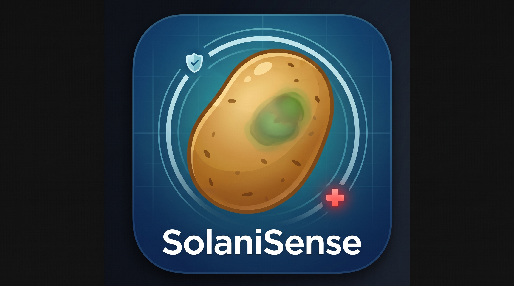
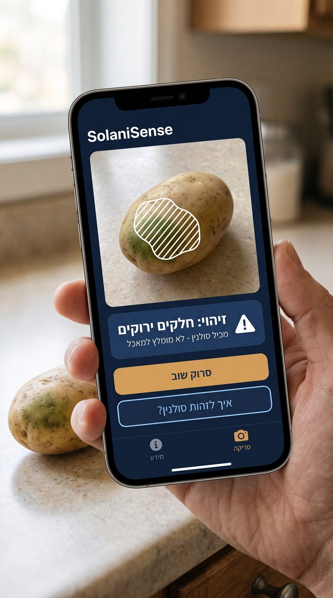
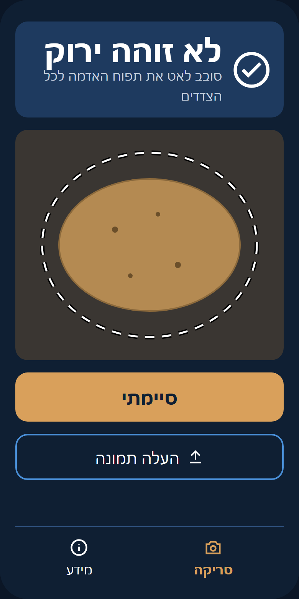
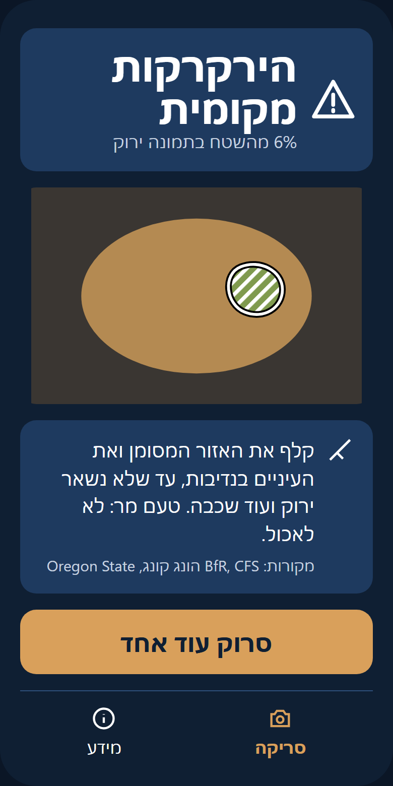
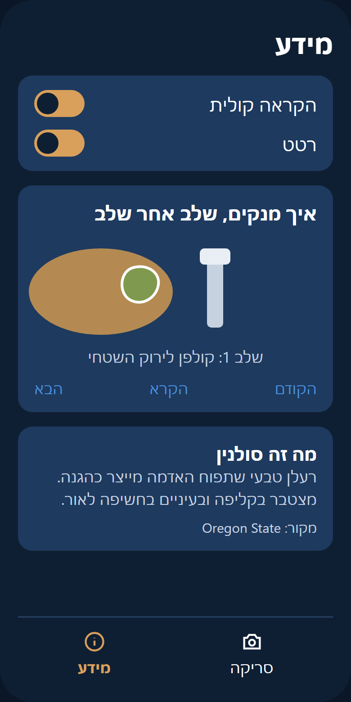

<p align="center"></p>

English version: [README.en.md](README.en.md)

# SolaniSense

אפליקציית PWA בעברית שמזהה הירקרקות בתפוחי אדמה, לעיוורי צבעים. מכוונים את מצלמת הטלפון לתפוח האדמה, והאפליקציה מסמנת את האזורים הירוקים ואומרת מה לעשות: לקלף בנדיבות או לא לאכול. הניתוח רץ במכשיר בלבד, והקוד של האפליקציה לא שולח לרשת שום מידע.

**סטטוס:** שלב 1, עד UI/UX. הזיהוי, שלושת המסכים והנגישות מומשו, ויש להם בדיקות שעוברות. העיצוב הוויזואלי (משימה 13) עוד לא הוחל: הממשק הנוכחי הוא טקסט לבן על רקע שחור, בלי ערכת העיצוב. הספים כוילו על תמונות סינתטיות בלבד.

**רישיון הפרויקט:** טרם נבחר. אין בריפו קובץ `LICENSE`.

## למה

עיוורי צבעים לא רואים את ההירקרקות בקליפה, ולכן אין להם דרך לדעת שתפוח האדמה נחשף לאור. הירוק עצמו אינו הרעלן: הוא סימן אזהרה לחשיפה לאור, שבה מצטברים גם סולנין וצ'אקונין, ולא מדד לכמות שלהם ([מחקר](docs/research/2026-10-17-greening-research.md), סעיף 1).

## מה האפליקציה עושה

- סריקה חיה: כל 300 מילישניות פריים מהמצלמה נבדק, והאזורים הירוקים מסומנים על הווידאו בפסים ובקו מתאר. אליפסה מקווקוות על הווידאו מראה את האזור שנבדק.
- שלוש רמות: "לא זוהה ירוק", "הירקרקות מקומית", "הירקרקות נרחבת". כל רמה מוצגת בטקסט ובצורה. בסריקה החיה, עלייה ל"מקומית" או ל"נרחבת" גם מוקראת ומלווה ברטט, ובמסך התוצאה פסק הדין מוקרא ומלווה ברטט פעם אחת, גם בתמונה שהועלתה.
- כל פריים רואה רק צד אחד של תפוח האדמה, ולכן הסריקה זוכרת את הפריים החמור ביותר ומציגה אותו במסך התוצאה, עם אחוז הירוק והנחיה מעשית.
- מסך מידע עם הנחיות בריאות, כל אחת עם המקור שלה (רשויות בריאות וספרות מדעית), ואנימציה של "איך מנקים".
- אחרי הביקור הראשון היא עובדת גם בלי רשת.

## מה היא לא עושה

האפליקציה אף פעם לא אומרת "בטוח" ולא מציגה "רמת סולנין". הצהרת האחריות, כפי שהיא מופיעה במסך המידע (`src/ui/content/info.ts`):

> האפליקציה מזהה ירוק בלבד, לא נבטים ולא רקב. התוצאה תקפה רק לתפוח אדמה שממלא את המסגרת. הספים הם ערכים הנדסיים, לא מאומתים רפואית. סורקים באור טבעי או לבן, כי תאורה צבעונית עלולה להטעות. כשלא זוהה ירוק, זה לא אומר שאין רעלן. במקרה של ספק: לא לאכול.

## דגמי מסך (המחשה)

שלושת הדגמים הבאים הם איורים של מערכת העיצוב המתוכננת, לא צילומי מסך של האפליקציה. הממשק הנוכחי עדיין לא מעוצב (ראה סטטוס למעלה). המקור: `docs/design/mockups/mockups.html`.

### תמונת קונספט



התמונה נוצרה ב-Gemini לפי [הפרומפט](docs/design/gemini-image-prompt.md) כהמחשת אווירה בלבד. הטקסטים שעליה אינם הניסוח של האפליקציה: האפליקציה לעולם לא כותבת "מכיל סולנין", כי ירוק הוא סימן אזהרה ולא מדידת רעלן. המקור ברזולוציה מלאה: `docs/design/concept/app-concept.jpeg`.

| סריקה חיה | תוצאה | מידע |
|---|---|---|
|  |  |  |

## המסכים

**סריקה.** המסך הראשי. בכניסה יש כפתור אחד, "התחל סריקה", והמצלמה נפתחת רק אחרי הלחיצה: האחורית, ואם אין כזו, אחרת. בראש המסך פסק הדין, שמופיע רק אחרי שנבדק פריים מואר כראוי, ומתחתיו ההנחיה "מלא את המסגרת בתפוח האדמה וסובב אותו לאט לכל הצדדים". "לא זוהה ירוק" מחכה לעשרה פריימים מוארים, כשלוש שניות, כי כל פריים רואה צד אחד. עד אז מופיעה רק ההנחיה. ירוק מוצג מיד. הווידאו מוצג במלואו, והסימון מצויר מעליו. על הווידאו מצוירת גם האליפסה שהמנתח בודק, בקו לבן מקווקו עם הילה שחורה, כבר לפני הפריים הראשון, כדי שיהיה ברור מה למלא בתפוח האדמה. כשהתאורה חלשה או צבעונית מופיעה הודעה, ופסק הדין קופא עד שהאור משתפר. "סיימתי" עובר למסך התוצאה. "העלה תמונה" מנתח תמונה אחת ועובר ישר לתוצאה. בלי הרשאת מצלמה המסך מסביר איך לאשר אותה, ומשאיר רק את ההעלאה. ביציאה מהמסך, ב"סיימתי" ובטאב מוסתר המצלמה נכבית.

**תוצאה.** הפריים החמור ביותר עם הסימון, פסק הדין עם הצורה, אחוז הירוק (רק ב"מקומית" וב"נרחבת"; ב"מקומית" מעוגל כלפי מטה, כדי ש-9.9% לא יוצג 10%), וההנחיה המעשית לרמה, ומתחתיה המקורות שלה: "מקורות: BfR, CFS הונג קונג, Oregon State". כשהמסך נפתח עם פסק דין, פסק הדין מוקרא ומלווה ברטט פעם אחת, לפי ההגדרות, גם בתמונה שהועלתה. בכל תוצאה מופיעה גם אזהרת הזנים: "על קליפה אדומה או חומה מחוספסת הירוק עלול להיות מוסתר. טעם מר או נבטים הם סימני אזהרה גם בלי ירוק." אם לא נבדק אף פריים מואר כראוי, מוצגת הודעה ניטרלית, "לא נסרק דבר", בלי פסק דין. אם סריקה חיה לא ראתה ירוק אבל נמשכה פחות מעשרה פריימים מוארים, מוצגת הודעה ניטרלית אחרת, "הסריקה הייתה קצרה מדי. סרוק לפחות שלוש שניות וסובב את תפוח האדמה לכל הצדדים.", גם היא בלי פסק דין ובלי הקראה. תמונה שהועלתה פטורה מזה: היא תמונה אחת מכוונת. העלאה באמצע סריקה חיה מצטרפת לסריקה ואינה פטורה. "סרוק עוד אחד" פותח סריקה חדשה.

**מידע.** שבעה סעיפים: מה זה סולנין, סימני אזהרה, איך מאחסנים, איך מנקים, למה בישול לא עוזר, ילדים קטנים, וקליפה אדומה או חומה. ליד כל סעיף המקורות שלו, מתוך BfR, ‏CFS הונג קונג, Oregon State והספרות המדעית. אחריהם "איך מנקים, שלב אחר שלב": שלושה איורים שמתחלפים כל 4 שניות, עם הכפתורים "הקודם", "הקרא" ו"הבא". אחר כך מתגי ההקראה והרטט, שנשמרים במכשיר, והודעה כשאין במכשיר קול עברי. בסוף הצהרת האחריות.

**ניווט.** סרגל תחתון עם שני יעדים, "סריקה" ו"מידע". התוצאה היא מצב של הסריקה, לא יעד נפרד.

## איך הזיהוי עובד

הקוד ב-`src/core`. המקור המלא: [אפיון](docs/superpowers/specs/2026-10-17-solanisense-design.md), סעיף 4.

1. **פריים.** כל 300 מילישניות פריים מהווידאו, או תמונה שהועלתה, מוקטנים לרוחב 256 פיקסלים.
2. **אזור הבדיקה.** אליפסה במרכז הפריים, ברוחב ובגובה של 80% ממנו. ההנחה היא שתפוח האדמה ממלא את המסגרת. אין הפרדת רקע.
3. **CIELAB.** כל פיקסל עובר מ-RGB למרחב הצבע CIELAB: ‏`L*` הוא בהירות, `a*` נע מירוק (שלילי) לאדום (חיובי), ו-`b*` מכחול לצהוב. ‏`a*` שלילי פירושו ירוק.
4. **שני משטרים, לפי החציון.** החציונים של `a*` ושל `b*` באליפסה הם הגוון הבסיסי של הפריים, והם קובעים איך הוא נשפט. **משטר 1, חציון דמוי קליפה** (חציון `a*` לפחות ‎-10, או חציון `b*` עד 0): פיקסל נספר כירוק כש-`L*` שלו מעל 20 ו-`a*` שלו נמוך ביותר מ-11 מהחציון. אין סף מוחלט. גוון של תאורה מזיז את כל הפיקסלים יחד, וגם את החציון, ולכן ההפרש נשמר: כתם ירקרק חלש, שאור חם מעלה ל-`a*` חיובי, עדיין נמוך מהחציון ב-15. בכלל הקודם היה גם סף מוחלט, `a*` מתחת ל-‎-4, והוא מחק את הכתם הזה באור חם בלי שום אזהרה.
5. **משטר 2, חציון ירוק בבירור** (חציון `a*` מתחת ל-‎-10 וחציון `b*` מעל 0, הירוק-צהבהב של כלורופיל): כשרוב השטח ירוק, גם החציון ירוק, ואין לכלל היחסי ממה למדוד. אז פיקסל נספר כירוק כש-`a*` שלו מתחת ל-‎-4 ו-`L*` שלו מעל 20. בכלל הקודם המעבר הזה קרה כבר בחציון ‎-4, ואור קר או פלורסנט הוריד לשם קליפה צהובה נקייה, שנקראה אז "הירקרקות נרחבת". **המגבלות:** צד שרובו ירקרק בהיר, באור חם חזק, נשאר במשטר 1 בלי הפרש לגלות, ונקרא "לא זוהה ירוק"; כך גם כשבדיוק חצי מהאליפסה ירקרק בהיר, כי החציון נופל באמצע. וגוון ירקרק חזק על קליפה בהירה מקרב אותה לסף של משטר 2, שבו כל הפקעת נספרת. הפירוט ב"מגבלות ידועות".
6. **יחס.** מספר הפיקסלים הירוקים חלקי מספר הפיקסלים באליפסה.
7. **רמה:**

| רמה | יחס ירוק | טקסט | צורה | רטט | ההנחיה במסך התוצאה |
|---|---|---|---|---|---|
| `none` | פחות מ-1% | לא זוהה ירוק | וי בעיגול | בלי | "סובב לכל הצדדים. טעם מר או נבטים: לא לאכול." |
| `local` | מ-1% ועד פחות מ-10% | הירקרקות מקומית | משולש | פעימה של 200 מילישניות | "קלף את האזור המסומן ואת העיניים בנדיבות, עד שלא נשאר ירוק ועוד שכבה. טעם מר: לא לאכול." |
| `widespread` | 10% ומעלה | הירקרקות נרחבת | איקס | שלוש פעימות של 200 מילישניות, עם הפסקות של 100 | "לא לאכול." |

הסף 10% הוא החלטה זהירה של בעל הפרויקט. USDA משתמש ב-25% לדירוג שיווקי, ואף רשות בריאות לא קבעה אחוז. הרצפה של 1% היא ערך הנדסי נגד רעש.

8. **שער התאורה.** חציון `L*` מתחת ל-25 הוא "חשוך", וההודעה "התאורה חלשה". חציון `a*` מעל 45, או ערך מוחלט של חציון `b*` מעל 60 כשהפריים לא במשטר 2, הוא "צבעוני", וההודעה "התאורה צבעונית מדי, נסה ליד חלון". פריים כזה לא משנה את פסק הדין, ולא מסומן. הספים גבוהים בכוונה: אין בפריים שום נקודת ייחוס חוץ מתפוח האדמה עצמו, ולכן אי אפשר להבדיל בין קליפה צהובה לבין אור חם. לפי האפיון, קליפה צהובה מגיעה ל-`b*` של כ-45, וקליפה אדומה ל-`a*` של כ-35. בגרסה הראשונה, עם ספים של 35 ל-`b*` ו-20 ל-`a*`, תפוחי אדמה רגילים נחשבו "תאורה צבעונית", הפריימים שלהם נזרקו, וזה עלול היה להסתיר הירקרקות. את `b*` לא בודקים במשטר 2, כי הירוק של תפוח אדמה צהבהב, עם `b*` גבוה. שער התאורה לא תופס גוון ירוק, כי סף כזה היה מסתיר תפוח אדמה ירוק כולו.
9. **זיכרון הסריקה.** הסריקה שומרת את הרמה החמורה ביותר ואת הפריים שלה. רמה קלה יותר לא מחליפה אותה. בסריקה החיה הקראה ורטט רק כשהרמה עולה. הפריים המואר הראשון נשמר גם בלי ירוק, כדי שגם לתוצאה של תפוח אדמה נקי תהיה תמונה. הסריקה סופרת גם את הפריימים המוארים: "לא זוהה ירוק" מחכה לעשרה מהם (`MIN_OK_FRAMES_FOR_NONE`), וירוק לא מחכה.

כל הספים נמצאים רק ב-`src/core/analyzer/thresholds.ts`, ובדיקה נועלת את הערכים שלהם, כך ששינוי מכוון מחייב לעדכן אותה.

## נגישות

העיקרון: אף מידע לא מועבר בצבע בלבד.

- **טקסט.** פסק הדין בגודל 40 פיקסלים, מודגש.
- **צורה.** ליד כל פסק דין: וי בעיגול, משולש או איקס, כך שאפשר לזהות את הרמה בלי להבחין בצבעים.
- **סימון.** האזורים הירוקים מסומנים בפסים אלכסוניים לבנים ובקו מתאר לבן, עם שוליים שחורים כדי שייראו על כל רקע. בלי מילוי צבע. אותו ציור בסריקה החיה ובמסך התוצאה.
- **הקראה.** `speechSynthesis` בעברית (`he-IL`): בסריקה החיה בכל פעם שהרמה עולה, ובמסך התוצאה פעם אחת, כשהוא נפתח עם פסק דין. הודעה ניטרלית לא מוקראת. אפשר לכבות במסך המידע. כשאין במכשיר קול עברי, מסך המידע אומר זאת ומסביר איך להוסיף.
- **רטט.** דפוס שונה לכל רמה (בטבלה למעלה). אפשר לכבות. בדפדפן בלי רטט, כמו Safari ב-iOS, האפליקציה פשוט ממשיכה בלי רטט.
- **קורא מסך.** אזור פסק הדין בסריקה מסומן `aria-live="assertive"` ונשאר על המסך לאורך כל הסריקה, כדי שגם פסק הדין הראשון יוכרז. הצורה מוסתרת מקורא המסך, והטקסט נקרא. לתמונה במסך התוצאה יש תיאור בעברית עם פסק הדין, ועם האחוז כשיש.
- **כפתורים.** בגובה 56 פיקסלים לפחות. בסרגל הניווט היעד הפעיל מוצג בצבעים הפוכים, לא רק בגוון אחר, ומסומן `aria-current`.
- **לחיצת ההתחלה.** המצלמה נפתחת רק אחרי "התחל סריקה". iOS מאפשר הקראה, ו-Android רטט, רק אחרי מגע של המשתמש, ולכן הלחיצה הזו היא המגע שמשחרר אותם. כשההקראה מופעלת, הלחיצה גם מקריאה משפט ריק, כדי שההקראות שיבואו אחריה יעבדו ב-iOS. גם הלחיצה על "העלה תמונה" עושה זאת, כי מסך התוצאה מקריא את פסק הדין של התמונה אחרי הפענוח, מחוץ לכל לחיצה. לא נבדק על מכשיר iOS.
- **תנועה.** האנימציה של "איך מנקים" לא מתחלפת לבד כשהמשתמש ביקש בהגדרות המכשיר פחות תנועה, ומפסיקה להתחלף לבד אחרי הלחיצה הראשונה.
- **כיוון ושפה.** `dir="rtl"` ו-`lang="he"` על השורש.

## מגבלות ידועות

- **לא מזהה נבטים ולא רקב.** רק ירוק.
- **אין הפרדת רקע.** כל האליפסה נבדקת. רקע ירוק, כמו דשא או מגבת, שממלא את המסגרת ייקרא "הירקרקות נרחבת", וקיר לבן ייקרא "לא זוהה ירוק" (ובאור ירקרק חזק "הירקרקות נרחבת", ראה "אור קר או ירקרק על קליפה נקייה" למטה). לכן ההנחיה הקבועה היא למלא את המסגרת.
- **הספים לא מאומתים רפואית.** הם ערכים הנדסיים, ו-10% הוא החלטה זהירה ולא תקן.
- **קליפה אדומה או חומה מחוספסת מסתירה ירוק.** הרעלן יכול לעלות גם בלי ירוק נראה. לכן אזהרת הזנים מופיעה בכל תוצאה.
- **צד שרובו ירקרק בהיר, באור חם חזק, נקרא "לא זוהה ירוק".** כתם ירוק על קליפה נשאר גלוי באור חם, כי הכלל יחסי לחציון. אבל כשהירקרק הבהיר תופס יותר מחצי מהאליפסה, החציון הוא הירקרק עצמו, ואור חם מעלה אותו ל-`a*` חיובי: הפריים נשאר במשטר 1, ואין הפרש לגלות. כך גם כשבדיוק חצי מהאליפסה ירקרק בהיר, באור יום, חם וקר, כי החציון נופל באמצע (בכלל הקודם זה נקרא נרחבת באור יום ובקר). בפלורסנט של מטריצת התאורה זה נקרא "הירקרקות נרחבת", אבל רק בהפרש של 0.06 מהסף של משטר 2. שער התאורה לא מתריע על אור כזה. ההגנה: הסריקה זוכרת את הצד החמור ביותר, ולכן סיבוב תפוח האדמה מראה גם צדדים שבהם הירוק הוא מיעוט, וההנחיה הקבועה, אזהרת הזנים והצהרת האחריות. הפתרון האמיתי: כיול על תמונות אמיתיות.
- **אור קר או ירקרק על קליפה נקייה.** רעש ומרקם של הקליפה עלולים לתת פגיעות מפוזרות, ובמטריצה הן נשארות מתחת לרצפת הרעש (0.12% עד 0.40% ברעש בסטיית תקן 6), אבל מרקם חזק יותר יקרב אותן ל"מקומית". גוון ירקרק חזק מעט יותר מהפלורסנט של המטריצה מוריד קליפה צהובה נקייה לסף של משטר 2, ואז כל תפוח האדמה נספר ונקרא "הירקרקות נרחבת"; קיר לבן באור הפלורסנט של המטריצה כבר נקרא כך. זה כיוון הטעות הבטוח. שער התאורה לא בודק גוון ירוק, כי סף כזה היה מסתיר תפוח אדמה ירוק כולו. המרווחים שנמדדו ב-[`test-images/README.md`](test-images/README.md).
- **קליפה אדומה כהה מאוד** עלולה לעבור את סף התאורה הצבעונית (חציון `a*` מעל 45): בדגימות סינתטיות קליפות כאלה הגיעו ל-`a*` של 42 עד 46 ([יומן ההחלטות](docs/decisions.md)). אז האפליקציה תציג "התאורה צבעונית מדי" ולא תשפוט את תפוח האדמה. לא נבדק על תמונות אמיתיות.
- **אין רטט ב-iOS.** Safari ב-iOS לא תומך ב-Vibration API.
- **הקול העברי תלוי במכשיר.** כשאין קול עברי מותקן, ההקראה עלולה לשתוק או להישמע בשפה אחרת. האפליקציה לא בוחרת קול: אם הדפדפן בוחר קול רשת, הוא שולח לספק הקול את המשפט המוקרא, שהוא מחרוזת קבועה של האפליקציה.
- **במסך התוצאה הכרזה אוטומטית של קורא מסך לא מובטחת**, כי אזור פסק הדין שם נטען כשהוא כבר מלא.
- **הכיול על תמונות סינתטיות בלבד.** 28 תמונות מחוללות, עד שיצולמו תמונות אמיתיות לפי `test-images/README.md`.
- **עדכון גרסה עלול לטעון את הדף מחדש באמצע סריקה**, בגלל `registerType: 'autoUpdate'`. הפירוט ב-[סקירת האבטחה](docs/security-review.md).

## הרצה

צריך Node 24 (נבדק עם 24.19.0) ו-npm. ‏`npm test` מריץ סקריפט bash, ולכן ב-Windows צריך Git Bash.

```bash
npm install
npm run dev        # http://localhost:5173
npm run build      # בנייה לתיקייה dist
npm run preview    # מגיש את dist ב-http://localhost:4173
```

ה-service worker, ואיתו העבודה בלי רשת, פעיל רק בבנייה (`npm run build` ואז `npm run preview`), לא ב-`npm run dev`.

**בדיקה בטלפון.** הדפדפן נותן גישה למצלמה רק בהקשר מאובטח: HTTPS או `localhost`. כתובת כמו `http://192.168.1.10:5173` אינה כזו, ושם האפליקציה תציג "אין גישה למצלמה" ותשאיר רק העלאת תמונה. שתי דרכים:

- **העברת פורט ב-USB אל `localhost`.** ב-Android: מפעילים בטלפון "ניפוי באגים ב-USB" ומחברים בכבל, פותחים במחשב את `chrome://inspect`, מוסיפים ב-Port forwarding את הפורט `5173` אל `localhost:5173`, ובטלפון פותחים את `http://localhost:5173`.
- **HTTPS**, למשל בנייה שמאוחסנת בשרת עם HTTPS.

לא להריץ `npm run dev -- --host` ברשת לא מוכרת: זה חושף את שרת הפיתוח לכל הרשת ([סקירת האבטחה](docs/security-review.md), סעיף 4).

## בדיקות

```bash
npm test                                      # טוהר core, ואז Vitest: יחידה, רגרסיה ומטריצת התאורה
npx playwright install --only-shell chromium  # פעם אחת, לפני הקצה-לקצה
npm run test:e2e                              # Playwright, מול npm run dev או מול שרת שכבר רץ על 5173
```

### מטריצת הבדיקות (נכון ל-2026-10-18)

| סוג | כלי | מיקום | בדיקות | מה נבדק |
|---|---|---|---|---|
| טוהר `core` | bash ו-grep | `scripts/lint-core.sh` | סקריפט אחד | ש-`src/core` לא מייבא React, `platform` או `ui` ולא נוגע ב-DOM |
| יחידה: `core` | Vitest | `src/core` | 58 | המרת צבע, המנתח (כולל פיקסל אחד, פריים 0x0, אורך נתונים שגוי, לבן מלא, ירוק מלא, פריים לא ריבועי ושער התאורה), שני המשטרים תחת גוון חם, קר ופלורסנט (כתם ירקרק חלש, קליפה צהובה נקייה, רעש גאוסי בזרע קבוע, חצי ירקרק, קיר לבן), פסק הדין, מצב הסריקה וספירת הפריימים, ונעילת הספים |
| מטריצת תאורה | Vitest | `src/core/analyzer/lightingMatrix.test.ts`, `test-images/` | 30 | 28 תמונות סינתטיות, בדיקה שלכל תמונה בתיקייה יש תשובה צפויה, והקטנה ופענוח של JPEG |
| יחידה: `platform` | Vitest | `src/platform` | 35 | מצלמה (הפעלה, כיבוי, ביטול), הקראה, רטט ואחסון |
| יחידה: `ui` | Vitest ו-Testing Library | `src/ui` | 66 | שלושת המסכים, פסק הדין, הסימון ומסגרת האזור הנבדק, עשרת הפריימים לפני "לא זוהה ירוק", ההקראה והרטט במסך התוצאה, מקור ההנחיה, הניווט והאפליקציה כולה |
| קצה-לקצה | Playwright ב-Chromium | `e2e/scan.spec.ts` | 6 | העלאת תמונה עם כתם (כולל מקור ההנחיה), תמונה חומה, RTL, מקורות והצהרת אחריות, מתג ההקראה, וקובץ פגום |

בסך הכול 189 בדיקות Vitest ב-16 קבצים, ו-6 בדיקות קצה-לקצה. כולן עוברות. כל הרצה של `npm test` היא גם בדיקת הרגרסיה.

### מטריצת התאורה

`test-images/synthetic/` מכילה שש תאורות (אור יום, נורה חמה 2700K, נורה קרה 6500K, פלורסנט, מעורבת, חשוכה) כפול ארבעה סוגים: תפוח אדמה חום נקי, עם כתם ירוק, עם כתם ירקרק חלש, וקליפה צהובה נקייה. בנוסף יש קליפה חומה עם רעש גאוסי מזרע קבוע, באור יום, קר ופלורסנט, ותמונה אחת של ירוק נרחב באור יום: 28 תמונות. התמונות מחוללות ב-`node scripts/make-lighting-matrix.mjs`, והתשובה הצפויה לכל אחת נמצאת ב-`test-images/expected.json`. עדיין אין תמונות אמיתיות.

**הוספת תמונות אמיתיות.** הפירוט המלא ב-[`test-images/README.md`](test-images/README.md):

1. מצלמים בשישה תנאי תאורה, ובכל תנאי תפוח אדמה נקי ותפוח אדמה עם ירוק. תפוח האדמה ממלא את המסגרת, בלי פלאש.
2. שומרים כ-JPEG או PNG, לא HEIC. מוחקים מהקובץ את המיקום, כי הריפו ציבורי, וכדאי להקטין לרוחב של כ-1000 פיקסלים.
3. שמים ב-`test-images/real/<condition>-<kind>-<n>.jpg`, למשל `test-images/real/warm-2700k-green-1.jpg`.
4. מוסיפים ל-`test-images/expected.json` שורה עם התשובה הנכונה, שנקבעת בעין לפני ההרצה. מי שלא מבחין בירוק מבקש ממישהו שרואה צבעים.
5. מריצים `npm test`. תמונה שנכשלת מדפיסה את היחס, פסק הדין, התאורה והחציונים. שינוי סף נעשה רק ב-`thresholds.ts`, ואחריו מעדכנים את הנעילה (`npx vitest run src/core/analyzer/thresholds.test.ts -u`) ומוסיפים שורה ליומן הכיול.

## מבנה הקוד

```
src/
  core/       TypeScript טהור: המרת צבע, המנתח, הספים, פסק הדין ומצב הסריקה
  platform/   ממשק ומימוש Web: מצלמה, הקראה, רטט, ואחסון ההגדרות
  ui/         React: המסכים, הרכיבים, המחרוזות והתוכן
  main.tsx    הרשמת ה-service worker והרכבת האפליקציה
```

- **`core`** לא תלוי ב-DOM, ב-React או ב-Web API, ולכן הוא נבדק ביחידה בלי דפדפן, ויכול לרוץ כמו שהוא גם מחוץ לדפדפן. `scripts/lint-core.sh` אוכף את זה בתוך `npm test`.
- **`platform`** עוטף את המצלמה, ההקראה והרטט בממשקים (`Camera`, `Speech`, `Haptics`), ואת אחסון ההגדרות בשתי פונקציות. ה-UI ניגש ליכולות האלה רק דרכו, ולכן מעבר ל-Capacitor יחליף רק את המימושים.
- **`ui`** מחבר ביניהם. אין ראוטר: המסך הנוכחי הוא מצב ב-`App`.
- **`Analyzer`** (`src/core/analyzer/types.ts`) הוא ממשק. מנוע AI עתידי יהיה מימוש נוסף שלו, לצד המנתח המקומי.

## מפת הריפו

```
src/              קוד האפליקציה: core, platform, ui
e2e/              בדיקות הקצה-לקצה ותמונות ההעלאה שלהן
test-images/      מטריצת התאורה: תמונות, תשובות צפויות והוראות צילום
scripts/          מחוללי תמונות הבדיקה והאייקונים, ובדיקת הטוהר של core
public/           אייקוני ה-PWA
docs/             אפיון, תוכנית, מחקר, יומן החלטות, עיצוב, רישיונות וסקירת אבטחה, ולוגו ה-README ב-docs/assets
logo/             הלוגו המקורי
buildin_model/    תרשים מודל הפיתוח
index.html        דף הכניסה, עם מדיניות ה-CSP
CLAUDE.md         כללי הפרויקט
package.json      התלויות והפקודות
*.config.ts       הגדרות Vite, Vitest ו-Playwright
tsconfig*.json    הגדרות TypeScript
```

## תהליך הפיתוח

[מודל הפיתוח](buildin_model/building_model.jpeg) מתאר את הדרך מרעיון לאפליקציה: רעיון, גיבוש ואפיון עם Claude, תוכנית עבודה, ואז רצף שלבים ב-Claude Code: ‏`CLAUDE.md`, תכנון וארכיטקטורה, מימוש, בדיקות ומקרי קצה, סקירת אבטחה וקומיט. במקביל תיעוד ב-Obsidian, הקוד ב-GitHub, ובסוף עיצוב הממשק ב-Stitch.

בפועל:

1. **מחקר ואפיון.** [המחקר](docs/research/2026-10-17-greening-research.md) אסף את הממצאים ואת הנחיות הרשויות, עם המקורות ותאריך הגישה. [האפיון](docs/superpowers/specs/2026-10-17-solanisense-design.md) נכתב על בסיסו ואושר.
2. **תוכנית.** [התוכנית](docs/superpowers/plans/2026-10-17-solanisense-phase1.md) מחלקת את השלב ל-14 משימות, כל אחת עם הקבצים, הצעדים והקומיט שלה.
3. **ביצוע בסוכנים, משימה אחר משימה.** כל משימה, או כמה משימות קשורות יחד, עוברת לסוכן מבצע עם תדריך. הוא כותב בדיקות וקוד ועושה קומיט. סוקר נפרד בודק את השינוי מול האפיון והתוכנית, וממצאים חוזרים לסבב תיקון עם קומיט משלו, עד שהסקירה נקייה. `CLAUDE.md` קובע תכנון עם Fable 5.1 וביצוע עם Opus 5.5.
4. **כללי הפרויקט** ב-[`CLAUDE.md`](CLAUDE.md): עברית ו-RTL תמיד; אף מידע לא בצבע בלבד; אין "בטוח" ואין "רמת סולנין"; כל הנחיה בריאותית עם מקור; `core` טהור; ספים רק ב-`thresholds.ts`; הערת `shortcut:` לכל קיצור דרך מכוון; רק ספריות ברישיון חופשי; קומיט אחרי כל שלב; ואחרי כל ביצוע בדיקות קצה-לקצה, מקרי קצה, רגרסיה וסקירת אבטחה.
5. **איפה ההחלטות.** באפיון (סעיף 11, "החלטות שנסגרו", ועדכונים שנכנסו בקומיטים `docs(spec): ...`) ובתוכנית, תחת `docs/superpowers/`. ההחלטות שהתקבלו במהלך הביצוע, והפריטים הקטנים שנדחו, ב-[`docs/decisions.md`](docs/decisions.md). החלטות הכיול ביומן שב-`test-images/README.md`, והחלטות הרישוי ב-`docs/licenses.md`. התדריכים, הדוחות ויומן העבודה של הסוכנים נשמרים מקומית בתיקייה `.superpowers/`, שאינה בריפו.

## מסמכים

- [אפיון](docs/superpowers/specs/2026-10-17-solanisense-design.md)
- [מחקר: הירקרקות תפוחי אדמה וסולנין](docs/research/2026-10-17-greening-research.md)
- [תוכנית המימוש](docs/superpowers/plans/2026-10-17-solanisense-phase1.md)
- [יומן ההחלטות בביצוע](docs/decisions.md)
- [טוקני העיצוב (Stitch)](docs/design/stitch-screens.md)
- [רישיונות](docs/licenses.md)
- [סקירת אבטחה](docs/security-review.md)
- [מטריצת התאורה והכיול](test-images/README.md)
- [כללי הפרויקט](CLAUDE.md)

## רישיונות

- **הפרויקט:** הרישיון טרם נבחר, ואין בריפו קובץ `LICENSE`.
- **התלויות:** כל חבילה ישירה, עם הגרסה והרישיון שלה, רשומה ב-[`docs/licenses.md`](docs/licenses.md). הרשימה המותרת: MIT, Apache-2.0, BSD-2-Clause, BSD-3-Clause, ISC, 0BSD. הקוד שנשלח לדפדפן מכיל רק את react, react-dom, scheduler ו-workbox, כולם MIT.
- **חריגות עקיפות, בפיתוח בלבד:** כמה תלויות עקיפות של כלי הבנייה והבדיקה נמצאות מחוץ לרשימה המותרת: lightningcss (‏MPL-2.0, דרך Vite 8 ו-Tailwind 4), חבילות ברישיונות MIT-0, BlueOak-1.0.0 ו-CC0-1.0 דרך jsdom, וחבילות ברישיונות BlueOak-1.0.0 ו-CC-BY-4.0 דרך workbox-build. אף אחת מהן לא נשלחת לדפדפן. כולן מתועדות ב-`docs/licenses.md`, וההחלטה אם לקבל אותן היא של בעל הפרויקט. גם הדפדפנים ש-Playwright מוריד, שחלקם ברישיונות אחרים (למשל LGPL של FFmpeg), נשארים במחשב הפיתוח.

## מה הלאה

- **עיצוב (משימה 13).** החלת ערכת העיצוב מ-[`docs/design/stitch-screens.md`](docs/design/stitch-screens.md). עבודה חלקית נמצאת בענף `wip/task13-design`, שלא מוזג ל-`main`.
- גופן Rubik יוגש מהריפו עצמו (OFL) ולא מ-Google Fonts, כדי לשמור על אופליין ועל אפס תעבורה.
- **כיול על תמונות אמיתיות.** צילום מטריצת התאורה לפי `test-images/README.md`, ואז כיוון הספים.
- **Capacitor.** אפליקציה מותקנת: מימושים חדשים ב-`src/platform` למצלמה, להקראה ולרטט, כולל רטט ב-iOS.
- **מנועי AI.** מימושים נוספים של הממשק `Analyzer`, לצד המנתח המקומי.
- **המלצות מסקירת האבטחה.** כותרות אבטחה מהאירוח (כולל `frame-ancestors`) והודעת עדכון במקום טעינה מחדש אוטומטית ([סעיף 5](docs/security-review.md)).
